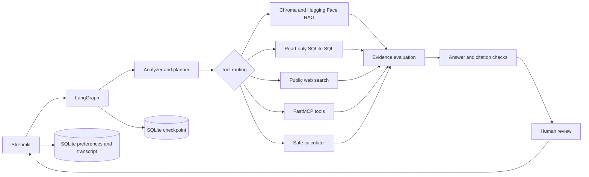

# Enterprise Agentic Research & Decision Platform

An evidence-first business research application that combines internal documents, read-only SQLite business data, optional public web research, and reusable MCP tools in a stateful LangGraph workflow.

**Live demo:** [Open Northstar Research](https://enterprise-agentic-research-platform-gcp6ywwyrwuexmwox2zb7q.streamlit.app/) · **Source code:** [GitHub repository](https://github.com/Integenpiyush/enterprise-agentic-research-platform)

## Features

- Upload and ingest PDF, TXT, Markdown, and CSV files with metadata and source citations.
- Local semantic retrieval with Hugging Face sentence embeddings and Chroma; a lexical fallback supports a no-install/no-API smoke run.
- Typed query planning and tool selection across document, SQL, web, calculator, and MCP tools.
- Validated read-only SQLite queries, row caps, explainable SQL visibility, and seeded synthetic business data.
- Bounded evidence correction, structured answer generation, citation checks, and human approval.
- Streamed LangGraph stage updates, conversation threads, SQLite checkpoints, and separate preference/transcript memory.
- FastMCP server and in-process MCP client discovery for document, database, and metric tools.
- Optional OpenAI answer/SQL generation and optional LangSmith tracing.
- Research report export, deterministic offline tests, and evaluation helpers.

## Quick start

Python 3.11 or newer (3.13 supported) is required. The complete embedding dependencies can be large because they include PyTorch and sentence-transformers.

```bash
python3.11 -m venv .venv
source .venv/bin/activate
python -m pip install --upgrade pip
pip install -r requirements.txt
cp .env.example .env
python data/seed_database.py
streamlit run app.py
```

To run tests without paid API calls:

```bash
pytest -q
```

Use the sidebar to open Research chat, Documents, Database analytics, or Memory & settings. The bundled policy and product documents can be searched immediately. Uploaded content and generated state live under `.local_data/`, which is ignored by Git.

## API keys and optional services

`OPENAI_API_KEY` enables the LangChain OpenAI structured planner/answer chain and natural-language SQL generation. Without it, deterministic planning, SQL mappings, retrieval, and evidence display continue to work. `LANGSMITH_API_KEY` together with `LANGSMITH_TRACING=true` enables tracing. Keep credentials in `.env` locally or Streamlit secrets in the cloud; never commit either.

Public web research uses the `ddgs` package and requires outbound network access. The app remains usable when that provider is unavailable; the tool failure is shown in execution events.

## Architecture

See [architecture](docs/architecture.md), [workflow](docs/workflow.md), [API reference](docs/api_reference.md), and the [interview guide](docs/interview_guide.md).



## Project layout

```text
app.py                    Streamlit entry point
src/                      Application packages (config, ingestion, retrieval, tools, graph, memory, MCP)
data/                     Seed script, synthetic documents, and evaluation prompts
tests/                    Unit and integration tests
docs/                     Architecture, workflow, API reference, interview guide
scripts/                  Setup, run, and evaluation commands
requirements.txt           Pinned runtime and development dependencies
```

## Screenshots and demo

Run `streamlit run app.py` to explore the four interactive workspace pages. No screenshots are bundled yet; the application is designed to be demonstrated with the synthetic corpus and sample database.

## Sample data

Every bundled document and database record is synthetic. The sample corpus covers a fictional refund policy, annual report summary, product guide, customer success playbook, security overview, and market brief. `data/sample_queries.json` and `data/evaluation_dataset.json` provide demonstration/evaluation prompts.

## Live deployment

The public app is deployed on Streamlit Community Cloud: [enterprise-agentic-research-platform](https://enterprise-agentic-research-platform-gcp6ywwyrwuexmwox2zb7q.streamlit.app/). It runs in local evidence mode without an OpenAI key; adding `OPENAI_API_KEY` in Streamlit app secrets enables LLM-backed planning and answers. Cloud filesystem storage may be ephemeral, so local Chroma indexes, uploaded files, conversations, and checkpoints should be replaced by managed persistent services for a durable production deployment.

## Security and limitations

- Only one SELECT statement is accepted; SQLGlot parsing is used when installed, and execution always uses a SQLite read-only URI with `query_only` and a row cap.
- Document and web text is untrusted evidence and must never override system instructions.
- Citation validation checks citation structure, not semantic entailment. Retrieval precision/recall helpers are simple lexical proxies, not a substitute for a labeled evaluation program.
- The retry behavior is a bounded corrective retrieval pass, not an exact Self-RAG or CRAG implementation.
- The project is a single-process demonstration, not a hardened multi-tenant service. Add authentication, authorization, tenant-scoped storage, retention controls, managed databases/vector storage, and deployment monitoring before production use.

## Tech stack

Python, LangChain, LangGraph, LangChain OpenAI, Hugging Face embeddings, ChromaDB, SQLite, FastMCP, LangSmith, Streamlit, Pydantic, and pytest.

## License

MIT; see [LICENSE](LICENSE).
