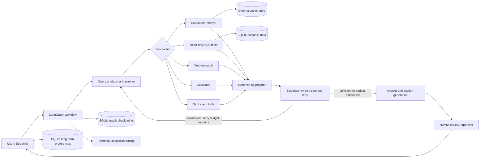

# Architecture

## Goals and boundaries

The platform answers business questions by combining synthetic or user-provided documents, a read-only SQLite business database, and optional public web research. The graph coordinates bounded, inspectable steps. Evidence and source metadata travel with the answer so that a reviewer can inspect the basis for claims.

The demo is a single-process Streamlit application. SQLite and local Chroma provide simple persistence; they are suitable for a local demonstration, not a multi-user production deployment. A production deployment should move identity, state, and vector storage to managed services and add authorization, tenant isolation, retention controls, and operational monitoring.

## Component view

## Data and control flow

1. The UI assigns a conversation thread ID and submits a query.
2. A typed analyzer/planner identifies the question's information needs and proposes allowed tool tasks.
3. The router dispatches only the requested and configured tools. Independent retrieval tasks can run concurrently.
4. Tool outputs are normalized into evidence records with source, locator, retrieval score or query details, and errors.
5. The evidence evaluator checks coverage and relevance. It may trigger a bounded corrective retrieval/replanning pass.
6. The answer chain produces a structured response with citations, uncertainty, and a verification result.
7. Human review gates finalization in interactive mode. Graph checkpoints preserve thread state; preference memory is stored separately.

## Security boundaries

- SQL access is read-only and query validation is allow-list based; generated SQL is also row-limited.
- Uploaded documents and local databases are runtime data and are excluded from Git.
- Tool inputs are schema-validated and tool failures are recorded rather than interpreted as evidence.
- Web content and documents are untrusted evidence, never instructions to the agent.
- API credentials come from environment variables or Streamlit secrets.

## Design choices and trade-offs

| Choice | Why | Alternatives and trade-offs |
|---|---|---|
| LangGraph for orchestration | Explicit state, routing, retries, checkpointing, and human review are central to the use case. | A single LangChain agent is simpler, but offers less control over bounded retries and review points. |
| Chroma local persistence | Easy to run locally and demonstrate ingestion/retrieval without external infrastructure. | Managed vector stores improve scale and availability but add cost and deployment setup. |
| SQLite business and state stores | Zero-service setup makes the demo reproducible. | PostgreSQL is preferable for concurrent production workloads and access controls. |
| Hugging Face sentence embeddings | Local embeddings avoid sending document text to an embedding API. | Hosted embeddings can improve quality or simplify deployment, with cost and data-transfer trade-offs. |
| Streamlit | Fast path to a reviewable research UI. | A separate API and React frontend offer more product flexibility with higher implementation cost. |
| FastMCP | Provides an interoperable tool server/client boundary. | Direct Python calls are simpler inside one process; MCP is useful when tools need independent discovery and reuse. |

## Interview discussion

Be ready to explain how state moves through graph nodes, why evidence records include provenance, how SQL restrictions are enforced beyond prompting, how retry budgets stop loops, why checkpoint persistence differs from preference memory, and what would need to change for concurrent multi-tenant deployment.
