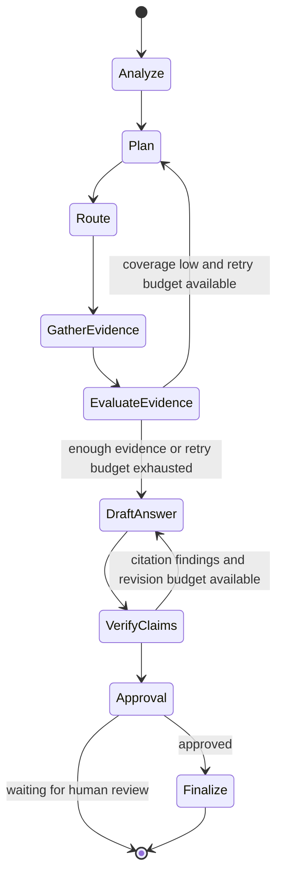

# Workflow and graph contract

The graph is an evidence-first orchestrator. Each node receives typed state and returns a partial update. Evidence lists are accumulated with a reducer; messages and per-node diagnostics remain associated with the request thread. A verifier can send citation-index findings to the answer chain for one bounded optimizer pass.

## State fields

The implementation will define typed fields for the user query, thread ID, conversation messages, plan, selected tasks, evidence, tool events, retry count, answer draft, verification findings, approval status, and errors. Reducers are used only for accumulating append-only lists; scalar decision fields use the latest node update.

## Retry and failure behavior

Retrieval correction and answer revision have explicit limits. A tool error is represented as a tool event and does not count as supporting evidence. If evidence remains weak after the retry budget, the answer must state the gap and avoid unsupported conclusions. Unexpected node errors are surfaced to the UI with a traceable run ID and a safe user-facing message.

## Human review

The graph uses a LangGraph interrupt to pause with a pending answer and evidence bundle. The UI presents approval and revision actions and resumes the checkpoint by thread ID. Reviewer feedback is preserved in the state for follow-up. No external side effect is performed by approval in the demo.

## Streaming and inspection

The UI will consume graph update events for stage progress and final state. A diagnostic view will show task selection, tool outcomes, SQL text, retrieved source metadata, and verification findings while avoiding credential disclosure.
